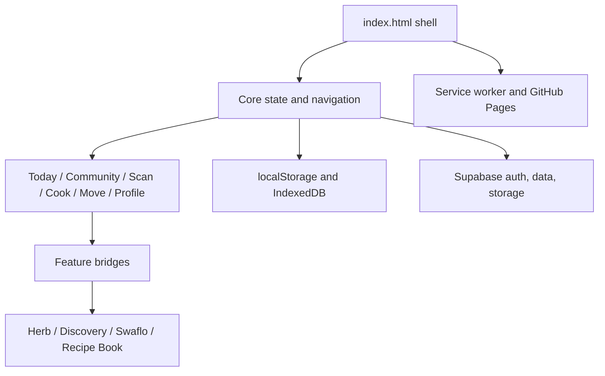

# LOWiSPIKE architecture

## Runtime overview

LOWiSPIKE is a static, browser-native PWA. It uses plain HTML, CSS, JavaScript, Web APIs, a service worker, and Supabase. There is no compilation step, router library, component framework, or package manager requirement.

The dependency direction should remain: pure logic/config → UI feature → host bridge. External feature files may use documented `window.*` bridges; they must not create a second copy of core state.

## Entrypoints and boot order

| Entry | Responsibility |
|---|---|
| `index.html` | Canonical document, inline CSS, application state, screen renderers, data catalogues, cloud client, and most interactions. Script order is significant. |
| `lowispike.html` | Compatibility redirect to `./`, preserving the URL hash. Do not add app logic here. |
| `manifest.webmanifest` | Standalone portrait PWA identity and icons. |
| `sw.js` | Network-first navigation, static fallback cache, push handling, and notification navigation. |
| `version.json` | Public build identifier and optional release news shown by the app. |

The document executes its inline modules in source order. Near the end it loads `recipe-book.js`, `appearance.js`, `apple-ui.js`, Discovery, and Swaflo. `apple-ui.js` then loads the herb files sequentially after `LowiR2` exists. Changing this order can break globals without a syntax error.

## Canonical state and navigation

The central mutable state is `S`, persisted under `lowispike.v2`. It owns the user profile, total XP, XP ledger, streak, quests, meal logs, saved swaps, health settings, local posts, reactions, and block/hide lists. `award()` is the only canonical XP write path.

The app does not use URL routes. `goTab()` changes the active DOM tab and calls one renderer from:

| Internal tab | User-facing destination | Renderer |
|---|---|---|
| `home` | Today | `renderHome` |
| `foryou` | Community | `renderCommunity` |
| `scan` | Scan | `renderScan` |
| `shelf` | Cook | `renderShelf` / Shelf and Cook layers |
| `move` | Move | `renderMoveTab` / `MOVE.showTab` |
| `profile` | Profile | `renderProfile`; normally opened from the header avatar |

Rendered tabs are cached and refreshed during idle time. A feature must tolerate being mounted again without adding duplicate listeners, nodes, rewards, or timers.

## Inline module catalogue

Most legacy modules are IIFEs or ordered script blocks inside `index.html`. Search for the listed comment or global rather than relying on line numbers.

### Shell, layout, and shared UI

| Global/module | Responsibility |
|---|---|
| `LowiLayout` | Viewport/layout state and `lowi:layout` event. |
| `LowiFit` | iOS standalone viewport correction and available-height fitting. |
| `LowiGlass` | Shared glass/background presentation behavior. |
| `LowiR2` | Core UI helpers, overlays/sheets, themes, toasts, and shared DOM utilities. |
| `LowiPF` | Reachable sticky sheet headers, close behavior, and swipe-down dismissal. |
| `LowiG2H`, `LowiG2C`, `LowiG2D`, `LowiG2E` | Phone-only compaction for Today, Cook, Community care board, and Profile. |
| `LowiCareBoard` | Care board math (`care-board-core.js`): sunbeams per week / month from the sun meter, tagged cloud keys, ranking. |
| `LowiLevels` | Misty's growth map: what Levels 1 to 6 give (her form, the Adventure reach, bubble glows), read from `LowiWorldHomeCore` and `LowiAdventureTiers`. |
| `LowiQ4b` | Hides the install prompt when another surface is active. |
| Header/profile-orb patch | Keeps the profile avatar current and gives the Scan button immediate press feedback. |

### Identity, onboarding, appearance, and language

| Global/module | Responsibility |
|---|---|
| `LowiAccess` | Free-account requirement and capability gating. |
| `LowiA1`, `LowiA2` | Intro/onboarding and install education. |
| Core onboarding | Name, birthday, avatar, goals/tags, and initial local state. |
| `LowiAuth`, `LOWI_CLOUD_X`, `LOWI_CLOUD` | Supabase authentication, session state, cloud API, and backup/restore. |
| `LowiLang` | English, German, and Spanish translation registry and DOM translation. |
| `LowiR3`, `LowiPF` | Rich profile/member presentation and profile sheets. |
| `appearance.js` | User-selected time, weather look, mood, and theme controls. It does not call location or weather services. |

### Today, fasting, quests, and reminders

| Global/module | Responsibility |
|---|---|
| `LowiFE` | Fasting timing and milestone text. |
| `LowiFast`, `LOWI_FAST`, `LowiFastStop` | Fasting state, card, start/stop flow, and end-fast reward sheet. |
| `LowiHome` | Home layout helpers. |
| `LowiF2` | Post-fast “what did you eat?” continuation and `lowi:meal-logged`. |
| `LowiF3`, `LowiF3B` | Six-part Daily Quest board and Home narration/compaction. |
| `LowiE1` | End-of-day ritual and once-daily closing reward. |
| `LowiN1` | In-app nudges and reminder settings. Navigation-driven companion speech is forbidden even though this older nudge system exists. |
| `LowiN1P` | Web-push subscription and reminder snapshot sent to the `n1-push` edge function. |
| `LowiLevels` | Level map and Level 7/8/9 unlock surfaces. This is separate from the herb's six visual evolution stages. |

### Food analysis, recipes, Scan, and Cook

| Global/module | Responsibility |
|---|---|
| `MEALS`, `TIPS`, recipe catalogues | Curated food/meal content and qualitative LOWiSPIKE rebuilds. |
| Rules engine | Parses typed/scanned food into JA/SELTEN/NEIN policy and qualitative spike guidance. It must not invent glucose values or medical certainty. |
| `LowiK9` | Ingredient search across recipes and shopping matches. |
| `LowiK1` | Recipe browsing, grouping, counts, and quick-first ordering. |
| `LOWI_COOK`, `LowiAllRecipes`, `LowiR3G` | Recipe catalogue, cooking mode, localized steps, and step images/offline behavior. |
| `LowiP2` | Scan/Cook result sheets, brands, recipe details, and one-shop basket behavior. |
| `LOWI_SHELF` | Cook/Shelf library, ingredient groups, finds, votes, lists, and shelf state. “Shelf” is an internal name; the user-facing tab is Cook. |
| `LowiStoreList`, `LowiCart` | Store choices and shopping/cart surfaces. Prices are estimates or explicitly sourced reports, never invented live prices. |
| `LowiDex` | Barcode camera/photo/manual scan, product lookup, Pokédex/catches, and product reports. |
| `LowiFood`, `LowiSwipeSFX` | Food swipe deck, shared foods, shuffle pool, outcomes, and direction sounds. |
| `LowiSwafloBridge` | Connects the existing recipe/saved-swap state to external Swaflo modules. Swaflo is an internal engine name, not an acceptable unexplained CTA. |

### Movement, body, and private health

| Global/module | Responsibility |
|---|---|
| `MOVE`, `LowiFit`, `LowiG2` | Movement catalogue, timers, accessible in-bed/seated/walking sessions, and the compact Move screen. |
| `R3W`, `T` | “Learn while you move” audiobook, session progress, speech, and evidence list. |
| `LowiCycle` | Period/cycle education and optional isolated `cycle_sync`. No diagnosis, fertility, or contraception claims. |
| `body-core.js` | Pure derivation for self-reported feelings, sleep, weight, movement context, and early personal patterns. It does not produce glucose curves or causal claims. |
| `body-companion.js` | Body diary/timeline UI. It may coexist as health UI but cannot render a second creature. |

### Community and social

| Global/module | Responsibility |
|---|---|
| `TRIBE`, `FYV`, `LowiFig` | Community/For You data, media feed, posting, and figure/media presentation. |
| Core chat and `cm*` functions | Chat messages, replies, mentions, reactions, and local fallback state. |
| Cloud community module | Maps Supabase posts, likes, messages, reactions, and profiles into local presentation. |
| `LowiR3F` | Community tabs and unified “New post” flow. |
| `LowiG2D` | Compact care board with the full ranking sheet and a Misty's growth tile. For You remains a scroll feed. |
| Community ordering module | Drag-reorders inner Community sections and keeps Profile ordering in sync. |
| `LOWI_BOTS` | Clearly local demo members/content. Never upload or misrepresent them as real users. |

### Audio and feedback

| Global/module | Responsibility |
|---|---|
| `LowiAudio` | Shared speech/toast audio behavior. |
| `LowiSFX` | Synthesized Web Audio reward/interaction kit and stored volume preference. |
| `LowiSwipeSFX` | Cook swipe-specific direction feedback using the shared sound preference. |
| `LowiCalmSoundCore` (`calm-sound-core.js`) | Pure calm-sound helpers (2026-10-16): singing-bowl strike plan, the timer chime that replaced the Move/guided-session beeps, and the string-pad maths (lanes, strums, loudness by height, bend by sliding, voice stealing, vibration). |
| `LowiSoundStrings`, `LowiCalmChime` (`sound-strings.js`, `sound-strings.css`) | The Sound panel's glass string pad (seven glowing strings, canvas 2D, drawn only while moving) played through `LowiWorldAudio.instrument()`; and `LowiCalmChime(ac, f, d)`, the soft bowl chime both timer `beep()` functions in `index.html` call. Silent when `LowiSFX.on()` is false. |
| `LowiWorldAudio` (`world-audio-core.js`, `world-audio.js`) | Opt-in world sound. Since 2026-10-16: soft pad + singing bowls (no noise band, no pulse); stormy-world cue is a deeper pad and slow low bowl. The panel opens with the string pad. `instrument()` hands the pad the audio context inside a user gesture. |

## External feature files

| Files | Ownership |
|---|---|
| `herb-config.js` | Six stage definitions, dim timing, and body-observation constants. |
| `herb-core.js` | Pure stage, zodiac, flavor, state synchronization, and ledger helpers. Reads canonical XP; owns no ledger. |
| `herb-tamagotchi-core.js` | Pure companion model: zodiac looks, moods, needs, copy pools, tap reactions, cosmetics, and reminder rules. |
| `herb-tamagotchi.js` | Companion DOM, Home card, Scan bubble, room, taps, care effects, evolution, naming, cosmetics, and reminder configuration. |
| `herb-tamagotchi.css` | Companion world, stage art, animation, responsive, and reduced-motion styles. |
| `herb-tamagotchi-polish.js`, `herb-tamagotchi-mount-fix.js` | Deliberately tiny compatibility shims. Do not grow them into parallel implementations. |
| `discovery-config.js`, `discovery-core.js` | Discovery constants and pure label/evidence/tier/price validation. |
| `discovery.js`, `discovery.css` | Discovery UI, product evidence, reports, drafts, photos, and field guide. |
| `swaflo-config.js`, `swaflo-core.js` | Adaptation defaults and pure matching/filtering/shopping logic. |
| `swaflo.js`, `swaflo.css` | Cook/Buy/Sweet-snack controls and result UI. |
| `recipe-book.js` | Per-account local recipe favorites and recipe-book sheet. |
| `apple-ui.js`, `apple-ui.css` | Sheet physics, focus management, accessibility polish, responsive nav, and herb asset loader. |
| `appearance.js` | Atmosphere/theme UI. |
| `weather-sky-core.js`, `weather-sky.js`, `weather-sky.css` | Live weather sky. Pure rules turn the Open-Meteo reading that `spirit.js` already caches (`lowi.weather.v1`) into condition, temperature band and real day/night (sunrise/sunset first, fresh `is_day` next, local clock last). One `#wxSky` layer, first child of `#app`, z-index 0, `pointer-events: none`, hidden while the scan camera is open, still under reduced motion. Sunrise theme mode follows the real sun through a wrapper on `LowiR2.themeEffective`; Night and Cloud stay as chosen. Loaded by the `apple-ui.js` herb loader before `spirit.js`. Never requests location itself. |
| `updates.css` | Install/update banners and related shell styling. |

| `region-pals-core.js`, `region-pals.js`, `region-pals.css` | Region companions (2026-10-16): one small glass creature per region (Brain Spark, Lungs Puff, Heart Pulse, Liver Hexa, Pancreas Isla, Gut Villo, Muscles Flex) on the world host (`.bw3-full` or `#whHud`). Says a greeting, the `arrival-core.js` facts and today's line in a Misty-blue speech bubble; tap for the next line. Follows drags (passive window listeners) and `lowi:region-steer` `{vx, vy}`. `arrival-cards.js` defers to `LowiRegionPals.takes(id)`, so regions show no gold card or Daily Quest line; the cell ride keeps its card. No XP, no storage, no collection, no microbes. |

## Assets and vendored code

- `steps/*.webp` contains recipe hero and numbered cooking-step images. Naming uses the recipe ID plus `_hero` or `_0..._5`.
- `icon-180.png`, `icon-192.png`, and `icon-512.png` are PWA icons referenced by the manifest and notifications.
- `vendor/supabase-2.117.3.js` and `vendor/zxing-0.21.3.min.js` are pinned third-party browser bundles. Never hand-edit them.
- `.agents/skills/apple-design/SKILL.md` is the repository design/motion instruction set. Use it for gesture and fluid-interface work.

## External services

- Supabase project: authentication, community data, profile/state backup, product catalogue/catches/reports, media storage, level unlock services, optional cycle sync, and push subscription handling.
- Open Food Facts: barcode fallback for product label data.
- ChatGPT custom GPT link: opens the separate LOWiSPIKE GPT experience.
- GitHub Pages: static production hosting.

The public Supabase browser key and VAPID public key are expected client-side public identifiers. Never add a service-role key or another secret to the repository.

## Known structural risk

The app accumulated chronological inline patches. Several modules wrap or rearrange earlier DOM rather than replacing it. That makes initialization order, idempotence, node identity, and event delegation critical. When extracting code from `index.html`, move one boundary without changing behavior, preserve its global API, add tests first, and ship extraction separately from a visual redesign.

## Spirit integration

`spirit-core.js` is pure logic for macros, local-day bonuses, gentle vitality, generated names, feed merging and elliptical physics. `spirit.js` owns one DOM creature moved between Home and the world, camera hosting, in-world sheets, meal forms, four-tap personality setup, generated SVG symbols and star-sign color presentation. The ordered herb loader loads herb config/core, Spirit core, herb model/UI and finally Spirit UI. `LowiVitalsBridge` owns native meal logging/editing, water logging, bonuses and the existing GPT URL. Level 1–6 now follows the herb milestones; legacy course/community unlock services remain a separate backend capability.

## Sign-in handoff module (`#hofjs`, end of index.html)

Self-contained IIFE, `window.LowiHandoff`. Hooks: R2 `startHTML()` (Paste block on the Home Screen start screen; also injected if the gate rendered first), R2 `signOut()`/`startFresh()` (revoke before sign-out), and it adapts the browser note `#lcA2hs` (owned by the update-notes module) for signed-in iPhone accounts. Backend: `supabase/functions/auth-handoff`. Tests: `tests/handoff.test.cjs` (offline), `tests/handoff-live.cjs` (backend, needs a service key in env).

## World-first Home
`world-home-core.js`, `world-home.js` and `world-home.css` load last through the existing ordered companion loader. Home reuses `LowiWorld3D` and its canvas; Today moves the existing status/log nodes into a sheet. Companion, fasting and appearance controls retain their existing bridges. No second renderer is created.
## Isolated Community chat module (pending integration, 2026-10-15)

`community-chat-core.js`, `community-chat-cloud.js`, `community-chat.js` and `community-chat.css` own Spirit square. The ordered `index.html` bridge exposes the existing authenticated client, message/reaction arrays and safe bubble renderer; `lowi:chat` invalidates the view. The existing cloud channel remains the only realtime subscription. Legacy chat seeds/render/send fallback no longer represent real activity. Replies, mentions, allowed reactions and owner deletion are provided by the module. Public identity comes only from consent-controlled `community_identities`; birthday/health are excluded. See `COMMUNITY_CHAT.md` for access blockers, unapplied backend proposal and verification limits.
